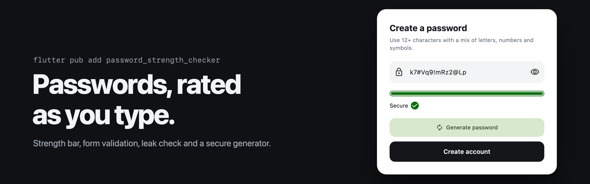
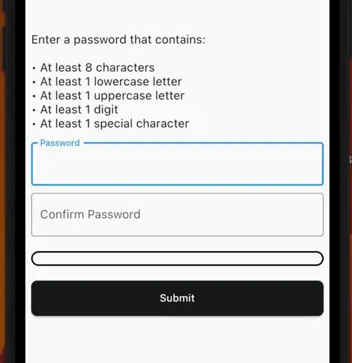
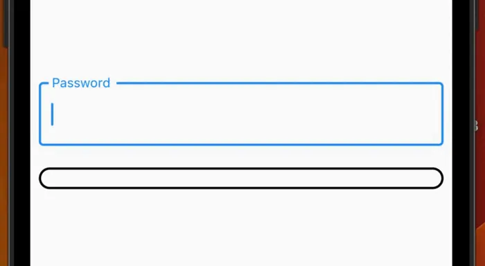
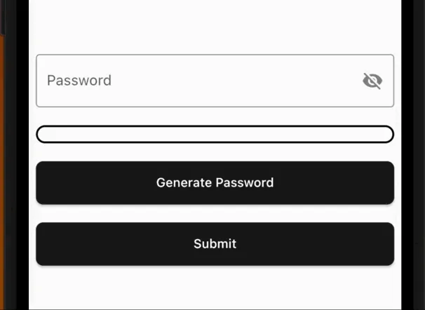

<p align="center">
  
</p>

<p align="center">
  <a href="https://pub.dev/packages/password_strength_checker"></a>
  <a href="https://pub.dev/packages/password_strength_checker/score"></a>
  <a href="https://pub.dev/packages/password_strength_checker/score"></a>
  <a href="https://github.com/dariowskii/password_strength_checker/actions/workflows/dart.yml"></a>
  <a href="https://github.com/dariowskii/password_strength_checker/blob/master/LICENSE"></a>
</p>

<p align="center">
  <b>Animated strength bar · Form validation · 10k leaked-password check · Secure generator</b><br/>
  Zero dependencies. Fully customizable. Bring your own strength rules.
</p>

---

## ✨ Features

| | |
|---|---|
| 📊 **`PasswordStrengthChecker`** | An animated bar that follows any `ValueListenable` of strength. Theme-aware (light and dark) and accessible. |
| 📝 **`PasswordStrengthFormChecker`** | A drop-in `Form` field. It validates against a `minimumStrengthRequired` and can show a confirmation field and a generate button. |
| 🛡️ **`isCommonPassword`** | Checks a password against the 10,000 most common leaked passwords. The match is case-insensitive. |
| 🎲 **`PasswordGenerator`** | Generates passwords with `Random.secure()` and per-class minimums. |
| 🎨 **Custom strength** | Implement `PasswordStrengthItem` on your own `enum` to define your own levels, colors and rules. |

## 🎬 Demo

<p align="center">
  
  
  
</p>

## 🚀 Getting started

```bash
flutter pub add password_strength_checker
```

```dart
import 'package:password_strength_checker/password_strength_checker.dart';
```

### Form field with validation

The widget calculates the strength for you. The form is valid only when the password reaches `minimumStrengthRequired`.

```dart
Form(
  key: formKey,
  child: PasswordStrengthFormChecker<PasswordStrength>(
    minimumStrengthRequired: PasswordStrength.secure,
    strengthCalculator: (text) => PasswordStrength.calculate(text: text),
    needConfirmation: true, // optional confirmation field
    showGenerator: true,    // optional "Generate password" button
  ),
);
```

Pass `controller`, `decoration`, `focusNode` or `autovalidateMode` to tune the default field. For full control, use `fieldBuilder` to plug in your own field:

```dart
PasswordStrengthFormChecker<PasswordStrength>(
  minimumStrengthRequired: PasswordStrength.strong,
  strengthCalculator: (text) => PasswordStrength.calculate(text: text),
  fieldBuilder: (context, data) => MyFancyField(
    controller: data.controller,
    validator: data.validator,
  ),
);
```

➡️ [Full example](https://github.com/dariowskii/password_strength_checker/blob/master/example/password_strength_form_checker_example.dart)

### Strength bar only

```dart
final strength = ValueNotifier<PasswordStrength?>(null);

TextField(
  onChanged: (text) => strength.value = PasswordStrength.calculate(text: text),
);
PasswordStrengthChecker(strength: strength);
```

Use `PasswordStrengthCheckerConfiguration` to change the size, the border, the animation, the direction and the status widget.

➡️ [Full example](https://github.com/dariowskii/password_strength_checker/blob/master/example/password_strength_checker_example.dart)

### Password generator

```dart
const generator = PasswordGenerator(
  PasswordGeneratorConfiguration(length: 32, minUppercase: 8, minSpecial: 8),
);

final password = generator.generate();
```

➡️ [Full example](https://github.com/dariowskii/password_strength_checker/blob/master/example/password_generator_example.dart)

### Leaked password check

```dart
isCommonPassword('Password'); // true, case-insensitive
commonPasswords.length;       // 10000
```

## 📏 Default rules

`PasswordStrength.calculate` checks the rules in this order:

| Level | Rule |
|---|---|
| `alreadyExposed` | The password is in the 10k leaked list. |
| `weak` | Fewer than 12 characters, or only 1 character class. |
| `medium` | 2 character classes. |
| `strong` | 3 character classes. |
| `secure` | Lowercase + uppercase + digit + special character. |

A special character is anything that is not a letter, a digit or whitespace, Unicode included (`.`, `+`, `€`…). Accented letters such as `à` or `Ç` count as lowercase or uppercase letters.

## 🎨 Custom strength

```dart
enum MyStrength implements PasswordStrengthItem {
  weak,
  medium,
  strong;

  @override
  Color get statusColor => switch (this) {
    weak => Colors.red,
    medium => Colors.orange,
    strong => Colors.green,
  };

  @override
  double get widthPerc => switch (this) {
    weak => 0.3,
    medium => 0.6,
    strong => 1.0,
  };

  @override
  Widget? get statusWidget => Text(name);

  static MyStrength? calculate(String text) {
    if (text.isEmpty) return null;
    if (isCommonPassword(text) || text.length < 6) return weak;
    return text.length < 10 ? medium : strong;
  }
}

PasswordStrengthFormChecker<MyStrength>(
  minimumStrengthRequired: MyStrength.medium,
  strengthCalculator: MyStrength.calculate,
);
```

The enum order is the strength order: a value declared later counts as stronger.

## 🔄 Migrating from 1.x

| 1.x | 2.0 |
|---|---|
| `onChanged: (p, notifier) => notifier.value = PasswordStrength.calculate(text: p)` | `strengthCalculator: (p) => PasswordStrength.calculate(text: p)` |
| `textFormFieldConfiguration: TextFormFieldConfiguration(...)` | `controller`, `decoration`, `focusNode`, `obscureText`, `autofillHints`, `autovalidateMode`, or `fieldBuilder` |
| `confirmationTextFormFieldConfiguration` | `confirmationController`, `confirmationDecoration` |
| `onPasswordGenerated: (password, notifier) {}` | `onPasswordGenerated: (password) {}`. The strength updates automatically. |
| `generateButtonSize` (fixed 48 px `ElevatedButton`) | `generateButtonStyle`. The button is now a `FilledButton.tonal` that stretches to the form width. |
| `emptyTextErrorMessage: null` to allow an empty password | `emptyTextErrorMessage` is a non-null `String`, so an empty password is always invalid. |
| Default confirmation decoration had `errorStyle: TextStyle(height: 0)` | Default decorations show the error text. Pass your own `decoration` and `confirmationDecoration` to hide it. |
| `commonDictionary[text] == true` | `isCommonPassword(text)` or `commonPasswords.contains(text)` |
| `PasswordGenerator.fromConfig(configuration: c)` | `PasswordGenerator(c)` |
| `generate(printDebugInfo: true)` | Removed. It printed the password to the logs. |
| `PasswordGeneratorConfiguration(numberOfShuffles: n)` | Removed. One shuffle with `Random.secure()` is enough. |
| `specialChars: ['!', '@']` | `specialChars: '!@'` |
| `statusWidgetAlignment: MainAxisAlignment.start` | `statusWidgetAlignment: AlignmentDirectional.centerStart` |
| `inactiveBorderColor: Colors.black` (default) | `null` by default, which follows the theme's `outlineVariant`. |

Behavior change: any character that is not a letter, a digit or whitespace now counts as special, accented letters count as letters, and the leaked-password check is case-insensitive. Some passwords can therefore get a different strength than in 1.x.

## 🤝 Contributing

Bug reports, feature requests and pull requests are welcome in the [repository](https://github.com/dariowskii/password_strength_checker).

<a href="https://github.com/dariowskii/password_strength_checker/graphs/contributors">
  
</a>

---

<p align="center">Made with ❤️ by <a href="https://www.linkedin.com/in/dario-varriale/">dariowskii</a></p>
